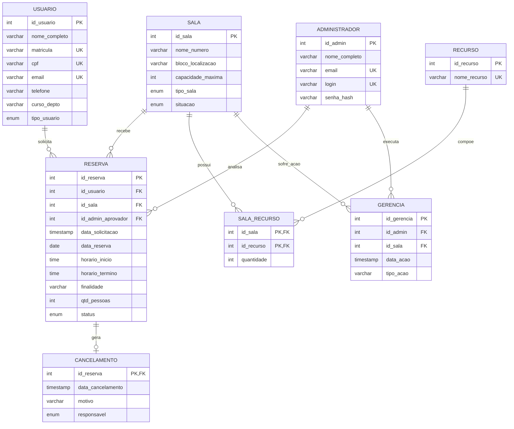

# Modelo Lógico Relacional (MER) — SalaShow (Reserva de Salas)

**Equipe:** Grupo 02 — Evellyn Priester, Anna Julia Soares, Selena Lory, Jullia Santini, Eduardo Barcelos  
**Disciplina:** Requisitos, Modelagem e Análise de Dados | 2026/2 – Prof. Edson Vaz Lopes  
**Versão:** v1.0  

---

## 1. Diagrama Entidade-Relacionamento (MER / Lógico)

> *Nota: Este diagrama utiliza sintaxe Mermaid e é renderizado automaticamente pelo GitHub.*

---

## 2. Especificação das Tabelas e Restrições

### 2.1 `usuario`
Armazena os dados dos solicitantes de espaço físico.
* **PK:** `id_usuario`
* **UNIQUE:** `matricula`, `cpf`, `email`
* **Atributos:**
  * `id_usuario` (`INT`, `NOT NULL`, `AUTO_INCREMENT`)
  * `nome_completo` (`VARCHAR(100)`, `NOT NULL`)
  * `matricula` (`VARCHAR(20)`, `NOT NULL`, `UNIQUE`)
  * `cpf` (`VARCHAR(11)`, `NOT NULL`, `UNIQUE`)
  * `email` (`VARCHAR(100)`, `NOT NULL`, `UNIQUE`)
  * `telefone` (`VARCHAR(15)`, `NULL`) — *Contato opcional*
  * `curso_depto` (`VARCHAR(50)`, `NOT NULL`)
  * `tipo_usuario` (`ENUM('Aluno', 'Professor', 'Funcionário')`, `NOT NULL`)

---

### 2.2 `administrador`
Armazena os gestores responsáveis pela manutenção das salas e aprovação de reservas.
* **PK:** `id_admin`
* **UNIQUE:** `email`, `login`
* **Atributos:**
  * `id_admin` (`INT`, `NOT NULL`, `AUTO_INCREMENT`)
  * `nome_completo` (`VARCHAR(100)`, `NOT NULL`)
  * `email` (`VARCHAR(100)`, `NOT NULL`, `UNIQUE`)
  * `login` (`VARCHAR(50)`, `NOT NULL`, `UNIQUE`)
  * `senha_hash` (`VARCHAR(255)`, `NOT NULL`)

---

### 2.3 `sala`
Armazena os espaços físicos disponíveis para agendamento.
* **PK:** `id_sala`
* **Atributos:**
  * `id_sala` (`INT`, `NOT NULL`, `AUTO_INCREMENT`)
  * `nome_numero` (`VARCHAR(50)`, `NOT NULL`)
  * `bloco_localizacao` (`VARCHAR(50)`, `NOT NULL`)
  * `capacidade_maxima` (`INT`, `NOT NULL`, `CHECK (capacidade_maxima > 0)`)
  * `tipo_sala` (`ENUM('Reunião', 'Laboratório', 'Aula', 'Auditório')`, `NOT NULL`)
  * `situacao` (`ENUM('Disponível', 'Em manutenção')`, `NOT NULL`, `DEFAULT 'Disponível'`)

---

### 2.4 `recurso`
Cadastro padronizado de recursos/equipamentos (atende à **RN-03**, evitando busca por texto livre).
* **PK:** `id_recurso`
* **UNIQUE:** `nome_recurso`
* **Atributos:**
  * `id_recurso` (`INT`, `NOT NULL`, `AUTO_INCREMENT`)
  * `nome_recurso` (`VARCHAR(50)`, `NOT NULL`, `UNIQUE`)

---

### 2.5 `sala_recurso` (Tabela Associativa — N:N)
Resolve o relacionamento muitos-para-muitos entre `sala` e `recurso` (originado do atributo multivalorado `{recursos_disponiveis}`).
* **PK Composta:** (`id_sala`, `id_recurso`)
* **FK:** `id_sala` → `sala(id_sala)`
* **FK:** `id_recurso` → `recurso(id_recurso)`
* **Atributos:**
  * `id_sala` (`INT`, `NOT NULL`)
  * `id_recurso` (`INT`, `NOT NULL`)
  * `quantidade` (`INT`, `NOT NULL`, `DEFAULT 1`, `CHECK (quantidade > 0)`)

---

### 2.6 `gerencia` (Tabela Associativa — N:N)
Registra o histórico de ações administrativas realizadas sobre as salas.
* **PK:** `id_gerencia` *(chave substituta para permitir múltiplas ações do mesmo admin na mesma sala)*
* **FK:** `id_admin` → `administrador(id_admin)`
* **FK:** `id_sala` → `sala(id_sala)`
* **Atributos:**
  * `id_gerencia` (`INT`, `NOT NULL`, `AUTO_INCREMENT`)
  * `id_admin` (`INT`, `NOT NULL`)
  * `id_sala` (`INT`, `NOT NULL`)
  * `data_acao` (`TIMESTAMP`, `NOT NULL`, `DEFAULT CURRENT_TIMESTAMP`)
  * `tipo_acao` (`VARCHAR(50)`, `NOT NULL`)

---

### 2.7 `reserva`
Registra as solicitações e agendamentos de salas. *(O atributo derivado `/duracao_minutos` não é armazenado fisicamente).*
* **PK:** `id_reserva`
* **FK:** `id_usuario` → `usuario(id_usuario)` (`NOT NULL`)
* **FK:** `id_sala` → `sala(id_sala)` (`NOT NULL`)
* **FK:** `id_admin_aprovador` → `administrador(id_admin)` (`NULL`)
* **Atributos:**
  * `id_reserva` (`INT`, `NOT NULL`, `AUTO_INCREMENT`)
  * `id_usuario` (`INT`, `NOT NULL`)
  * `id_sala` (`INT`, `NOT NULL`)
  * `id_admin_aprovador` (`INT`, `NULL`)
  * `data_solicitacao` (`TIMESTAMP`, `NOT NULL`, `DEFAULT CURRENT_TIMESTAMP`)
  * `data_reserva` (`DATE`, `NOT NULL`)
  * `horario_inicio` (`TIME`, `NOT NULL`)
  * `horario_termino` (`TIME`, `NOT NULL`, `CHECK (horario_termino > horario_inicio)`)
  * `finalidade` (`VARCHAR(255)`, `NOT NULL`)
  * `qtd_pessoas` (`INT`, `NOT NULL`, `CHECK (qtd_pessoas > 0)`)
  * `status` (`ENUM('Pendente', 'Aprovada', 'Recusada', 'Cancelada')`, `NOT NULL`, `DEFAULT 'Pendente'`)

---

### 2.8 `cancelamento` (Entidade Fraca — 1:0..1)
Armazena os dados de auditoria quando uma reserva é cancelada (atende à **RN-02**).
* **PK e FK:** `id_reserva` → `reserva(id_reserva)`
* **Atributos:**
  * `id_reserva` (`INT`, `NOT NULL`)
  * `data_cancelamento` (`TIMESTAMP`, `NOT NULL`, `DEFAULT CURRENT_TIMESTAMP`)
  * `motivo` (`VARCHAR(255)`, `NOT NULL`)
  * `responsavel` (`ENUM('Usuário', 'Admin')`, `NOT NULL`)